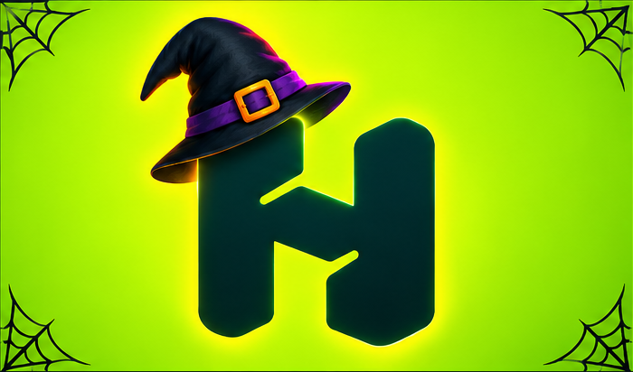

# 🎃 Haunted Handshake

### A Halloween costume for the Handshake H

**Haunted Handshake** gives the recognizable Handshake H a playful witchy makeover: a black hat with a purple band and orange buckle, delicate spiderwebs, and orange-purple glow against a neon lime background.

> Made for the **“Dress the Handshake Logo for Halloween”** challenge.

An AI-powered Halloween logo design challenge
About the project
A creative Halloween costume for the Handshake logo, made with ChatGPT image generation.

Features
- Witch hat and Halloween decorations
- Orange and purple glowing effects
- Original H shape and colors preserved as closely as possible
Tools: ChatGPT · GitHub · GitHub Pages

## The design

- **Keep the H recognizable:** preserve its central silhouette and dark teal color.
- **Make it Halloween:** add a witch hat, buckle, spiderweb corners, and colorful glow.
- **Keep the logo the star:** decorations frame the H rather than introducing other brands or characters.

## Final artwork

Open or download the [final Haunted Handshake image](assets/final-haunted-handshake.png).

## How it was made

The official logo was used as the visual reference for an AI-generated Halloween redesign. The prompt and source image are included so the project is easy to understand and review.

**Tools:** ChatGPT image generation · Visual review · Visual Studio Code

## Project files

| File | What it contains |
| --- | --- |
| [assets/final-haunted-handshake.png](assets/final-haunted-handshake.png) | Featured final design |
| [assets/handshakeavatar.png](assets/handshakeavatar.png) | Original Handshake logo reference |
| [assets/haunted-handshake.png](assets/haunted-handshake.png) | Alternate generated design |
| [assets/haunted-handshake-2.png](assets/haunted-handshake-2.png) | Alternate generated design |
| [prompts/image-prompt.txt](prompts/image-prompt.txt) | Image-generation prompt |
| [SUBMISSION.md](SUBMISSION.md) | Challenge submission checklist |

## Challenge

**Costume name:** Haunted Handshake  
**Challenge:** Dress the Handshake Logo for Halloween

This repository is the project portfolio. The final artwork is the image to submit to the challenge.
